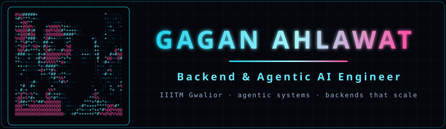
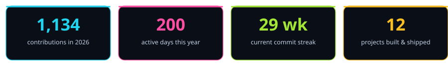
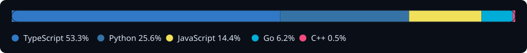
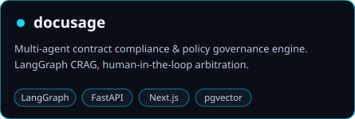
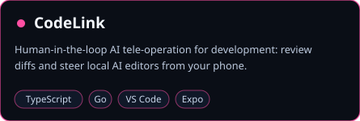
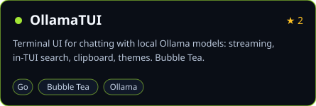
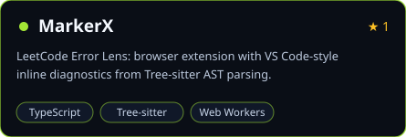

  

Backend and Agentic AI engineer, dual-degree (B.Tech IT + MBA) student at ABV-IIITM Gwalior.
I build agentic systems and the backends that carry them — multi-agent pipelines, local-LLM
tooling and realtime collaboration systems. Open-source contributor (krkn-ai, GitMesh).

  

  

### Featured builds

<table>
  <tr>
    <td></td>
    <td></td>
  </tr>
  <tr>
    <td></td>
    <td></td>
  </tr>
</table>

**Currently:** `credex` — cost-sensitive, explainable ML for credit-risk assessment
(replicating and extending Li &amp; Wu, 2024).

  <a href="https://gagan-ahlawat.vercel.app">portfolio</a> ·
  <a href="https://x.com/_gagan_ahlawat_">x/@_gagan_ahlawat_</a>

<!-- stats.svg and langs.svg are regenerated nightly by .github/workflows/readme-stats.yml -->
